# Agentic Overwatch

**Governed incident response for Kubernetes.**

A hierarchical LLM multi-agent research framework that investigates cloud-native incidents,
delegates bounded response tasks, and checks agent actions through a deterministic Guardian.
It combines the response framework with a seeded scenario harness and an auditable evaluation pipeline.

**Research prototype** · **Kubernetes** · **Python 3.12**

[Getting started](#getting-started) · [Architecture](#how-it-works) ·
[Experiments](#scenarios-and-experiments) · [Validation](#validation) ·
[Documentation](#documentation)

## Why Agentic Overwatch?

An LLM can propose a plausible response without having the authority to carry it out safely.
Incident response also needs bounded evidence, explicit task scope, and a record of what was
approved, attempted, and actually executed.

Agentic Overwatch separates model reasoning from policy enforcement. Agents request scoped
capabilities; the Guardian independently checks requests on the default action path. The experiment
harness lets researchers compare agent topologies and guardrail settings against the same scenarios.

## What it provides

- **Programmatic monitoring:** Falco, Prometheus/Alertmanager, Kubernetes audit events, and Trivy
  feed a non-LLM aggregator that normalizes, orders, bounds, and quotes evidence.
- **Hierarchical response:** an Orchestrator, four phase-specific Supervisors, fresh task Executors,
  and a Consolidator organize the incident-response lifecycle.
- **Scoped authority:** short-lived, single-use JWT capabilities bind tasks to a run, phase,
  identity, resource scope, and namespace.
- **Deterministic mediation:** FastAPI and OPA/Rego validate requests, apply deny-by-default policy,
  and record decisions before Kubernetes execution.
- **Auditable experiments:** seeded injections, model messages, spans, audit records, probes,
  assertions, and provenance are collected into hash-sealed run bundles for analysis.

## How it works



[Open the animated SVG](architecture/agentic-overwatch-architecture-runtime.svg) ·
[GIF version](architecture/agentic-overwatch-architecture-runtime.gif)

The walkthrough advances automatically. The lower-right card describes the active step and shows
its progress. It illustrates the current **S1-HIER / G0-FULL** runtime path, rather than a recorded incident.

1. **Observe.** Sensors feed the Monitor. The runner exports one evidence snapshot and makes it
   available to every phase.
2. **Plan.** The runner declares the active phase. The Orchestrator reads evidence and prior results;
   that phase's Supervisor receives the phase context and requests a capability for a task.
3. **Delegate.** The Guardian checks the requested scope and issues a token. A fresh Executor
   submits its proposed action through the Guardian client.
4. **Mediate.** The Guardian validates the token, replay state, action caps, and policy. It records
   the decision, attempts permitted operations through Kubernetes, then records the execution outcome.
5. **Close the phase.** The Executor reports back to its Supervisor. Task delegation can repeat
   within the phase budget. The Consolidator closes the phase, and the runner carries results forward.
6. **Seal and analyze.** The runner collects evidence and evaluates assertions. Validated, sanitized
   bundles are sealed before the analysis pipeline reads them.

The four phases run **sequentially**, with one active Supervisor at a time:

| Phase | Response focus |
|---|---|
| Detection and investigation | Observe the target environment and investigate evidence |
| Containment | Reduce exposure within the phase's permitted scope |
| Eradication | Remove or replace scoped compromised resources |
| Verified recovery | Observe and restore capacity within the permitted scope |

The executable authority ceiling is defined in [the Rego policy](guardian/policies/authority.rego).
The host runner drives the plan; agent roles run inside its process. The Guardian mediates the
default agent action path, while the runner separately retains operator privileges for the harness.

## Getting started

Run the commands below from the repository root in **Linux or WSL2 Ubuntu**, with Python 3.12
and GNU Make. The cluster path additionally requires Linux/amd64 tooling, Docker, and a kernel
with eBPF support.

### Try the evaluation pipeline without a cluster

This path needs no Kubernetes cluster or model-provider credential. It generates **synthetic data**
to exercise bundle sealing and analysis; it does not measure live agent performance.

```bash
python3.12 -m venv .venv
PYTHON=.venv/bin/python sh scripts/install_runtime_deps.sh

.venv/bin/python -m runner.synthetic --seed 101 --date 20260101
make analyze C=runs/CAMP-20260101-synthetic
```

Generated bundles live under `runs/CAMP-20260101-synthetic/`. Tables and figures are written to
its `_analysis/` directory. Runtime versions come from [infra/versions.env](infra/versions.env).

### Run the framework against the lab cluster

Complete the Python setup above, then install the pinned cluster tools:

```bash
sh scripts/install_cluster_tools.sh
```

Before full bring-up, configure model-provider access and the operator-supplied
`guardian-signing-key` and `guardian-audit-signing-key` secrets. Supply the matching audit public key
through `GUARDIAN_AUDIT_PUBLIC_KEY`. Start with the [secrets guide](docs/ops/secrets.md) and the
[Guardian deployment entry point](scripts/guardian_deploy.sh).

```bash
make up
make status
sh scripts/port_forward.sh up
. scripts/live_env.sh
```

Run one full-guardrail scenario with no prompt injection and an explicit two-minute measurement window:

```bash
make run COND=G0-FULL SCN=SCN-SIM-01 INJ=INJ-NONE SEED=101 CAMP=CAMP-demo DURATION=120
make analyze C=runs/CAMP-demo
```

A live run requires exactly one window setting: `DURATION=<seconds>` or `SAMPLES=<count>`.
The `120` seconds above is an example, not a default. Use the [operator runbook](docs/ops/runbook.md)
for environment operation and troubleshooting.

## Scenarios and experiments

The harness runs Online Boutique on **kind with Cilium**, with Locust providing application load.
Scenario code covers runtime shell/beacon activity, ServiceAccount escalation attempts,
checkout-path degradation, and CVE-pinned image scenarios.

| Explore | Location |
|---|---|
| Scenario definitions | [scenarios/manifests/](scenarios/manifests/) |
| Fault and traffic perturbations | [scenarios/chaosmesh/](scenarios/chaosmesh/) |
| Expected outcomes and assertions | [scenarios/groundtruth/](scenarios/groundtruth/) |
| Experimental condition mapping | [runner/conditions.py](runner/conditions.py) |
| Campaign configuration and evaluation design | [Evaluation protocol](docs/protocols/evaluation-protocol.md) |

The reference condition is **G0-FULL**, also named **S1-HIER**. Structural comparisons use
**S2-FLAT** and **S3-SINGLE**. Guardrail experiments use **G1-LOGONLY**, **G2-SHAREDCRED**, and
**G3-UNQUOTED**; these deliberately weaken different parts of the reference setup.

For a configured campaign:

```bash
make campaign M=<campaign-manifest> DURATION=<seconds>
```

Seeds control the scenario and injection plan. They do not guarantee identical outputs from a hosted model.

CVE scenarios require image preparation before a fresh run. Use
[the image build recipe](scenarios/cve/adservice/build_and_pin.sh) and
[the mirror utility](scripts/cve_mirror.sh). `sh scripts/cve_mirror.sh --save` prints pull/save
commands for review; it does not execute them. Recreate the archives and verify their recorded
checksums before running the CVE scenarios. Historical run data and local image archives are not included.
Create the archive destination with `mkdir -p scenarios/cve/tarballs` before executing the printed commands.
For newly built images, record the repository, digest, and archive checksum in
[the image manifest](scenarios/cve/images.yaml) using the build recipe's instructions.

## Validation

Checks are exposed through Make targets and shared scripts used by
[the CI workflow](.github/workflows/ci.yml). Choose the checks relevant to the component you change.

| Command | Checks |
|---|---|
| `make lint` | Python lint and formatting |
| `make guardian-test` | Rego policy tests and the Guardian adversarial suite |
| `make determinism-check` | Monitor and scenario replay determinism |
| `make parity-check` | Prompt and tool-budget parity across conditions |
| `make audit-verify P=<bundle-path>` | Guardian audit-chain integrity |
| `make fidelity-check` | Synthetic treatment-fidelity checks |
| `make help` | Available targets and parameters |

Component tests live alongside their code in `tests/` directories. See
[repository conventions](docs/04-repo-conventions.md) for the development workflow.

## Documentation

| Topic | Read next |
|---|---|
| Operating the environment | [Operator runbook](docs/ops/runbook.md) |
| Credentials and signing material | [Secrets guide](docs/ops/secrets.md) |
| Authority and mediation | [Security policy](docs/protocols/security-policy.md) |
| Evidence, bundles, and provenance | [Data-management protocol](docs/protocols/data-management.md) |
| Experimental comparisons | [Evaluation protocol](docs/protocols/evaluation-protocol.md) |
| Standing and shadow-mode deployment | [Shadow-mode guide](docs/ops/shadow-mode.md) and [Helm chart](deploy/helm/agentic-overwatch/) |
| Terminology and identifiers | [Glossary](docs/07-glossary-and-ids.md) |

## Research scope

Agentic Overwatch is a **research prototype for controlled experiments**, not a production-ready
incident-response service. Policy compliance and successful incident resolution are separate outcomes.
Agents receive a fixed evidence snapshot during a run; the current driver does not refresh telemetry
after each action. Sharing the host runner's process also means the agent layer is not a process-isolated
security boundary.

Use the executable code when assessing current behavior. Configure your own provider credentials
and Guardian signing material; previous experiments' credentials, traces, and scoring data are not included.

## License

This checkout does not currently include a repository-level `LICENSE` file.
